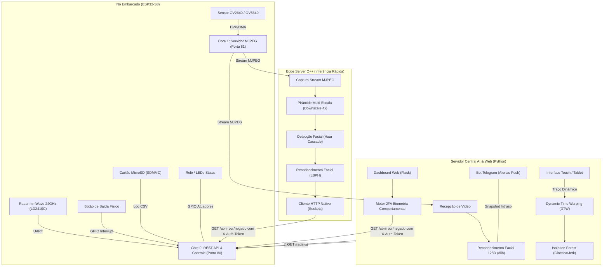
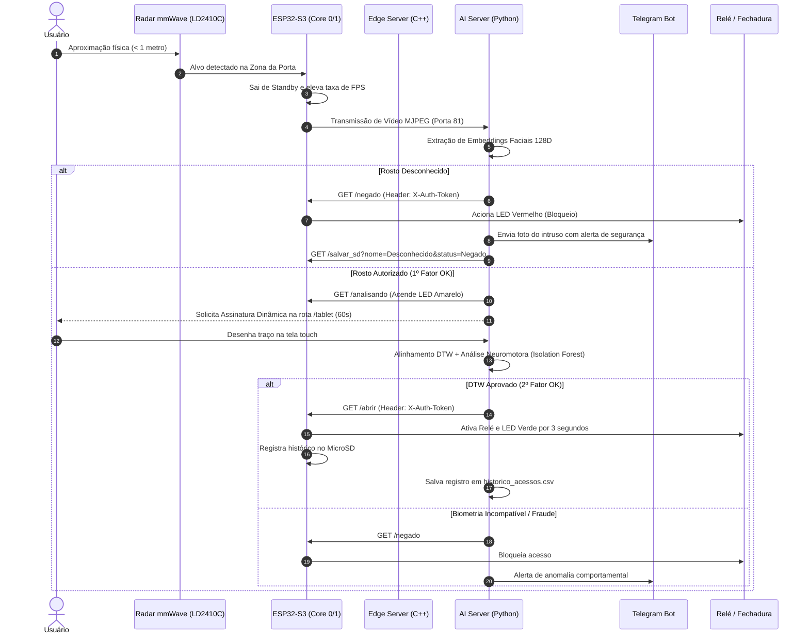

# Sistema Distribuído de Controle de Acesso Inteligente (IoT & Edge AI)

[](https://www.espressif.com/)
[]()
[]()
[]()

Monorepo contendo a solução completa de um sistema distribuído de segurança e controle de acesso biométrico multimodal. A arquitetura divide responsabilidades entre hardware embarcado de tempo real (**ESP32-S3**), servidor de inferência acelerado de borda (**C++17 / OpenCV**) e servidor central de inteligência artificial com dashboard web e biometria comportamental (**Python / Flask / DTW**).

---

## 🏛️ Visão Geral da Arquitetura Distribuída

O sistema foi concebido segundo o paradigma de **Computação de Borda (Edge Computing)**, desacoplando tarefas de sensoriamento, transmissão, inferência local e validação comportamental em três camadas interdependentes conectadas por rede local (Wi-Fi 2.4 GHz):



---

## 📂 Estrutura do Monorepo

```
.
├── firmware-esp32/             # Nó de sensoriamento e atuação embarcado
│   ├── CMakeLists.txt          # Configuração de build ESP-IDF
│   ├── partitions.csv          # Tabela de partições flash (App 3MB + NVS + OTA)
│   ├── sdkconfig.defaults      # Parâmetros padrão do SoC ESP32-S3
│   ├── main/
│   │   ├── config.h.example    # Template de credenciais de rede e tokens
│   │   ├── config.h            # Configuração local (ignorado pelo git)
│   │   ├── main.c              # Ponto de entrada do firmware FreeRTOS
│   │   ├── camera_module.c/.h  # Inicialização DVP e calibração de câmera
│   │   ├── radar_module.c/.h   # Driver UART do radar mmWave HLK-LD2410C
│   │   ├── server_module.c/.h  # Servidores HTTP Dual-Core (Portas 80 e 81)
│   │   ├── sd_module.c/.h      # Driver SDMMC para persistência off-line
│   │   └── wifi_module.c/.h    # Gerenciador de conexão Wi-Fi e mDNS
│   └── README.md
│
├── edge-server-cpp/            # Servidor de borda em C++17 para inferência contínua
│   ├── CMakeLists.txt          # Build CMake com integração OpenCV
│   ├── main.cpp                # Pipeline multi-escala e despacho em threads
│   ├── http_client.hpp/.cpp    # Cliente HTTP nativo (Winsock / POSIX Sockets)
│   ├── treinar_ia.py           # Script para treinamento do modelo LBPH
│   ├── haarcascade_frontalface_default.xml # Classificador pré-treinado
│   ├── .env.example            # Exemplo de variáveis de ambiente
│   └── README.md
│
├── ai-python/                  # Servidor biométrico multimodal e painel Web
│   ├── reconhecimento_porta.py # Servidor Flask multithread e orquestrador
│   ├── biometria_dtw.py        # Motor DTW e detecção de anomalia neuromotora
│   ├── detector.py             # Detector de pessoas e animais via YOLOv8
│   ├── assinaturas_cadastradas.json # Gabaritos das assinaturas biométricas
│   ├── dataset_comportamental.csv   # Dataset de métricas cinéticas
│   ├── rostos_permitidos/      # Imagens de referência dos usuários autorizados
│   ├── ia_caligrafia/          # Segmentação e processamento de caligrafia
│   ├── requirements.txt        # Dependências Python
│   ├── .env.example            # Variáveis de ambiente e credenciais
│   └── README.md
│
├── .gitignore                  # Regras globais de exclusão do monorepo
└── README.md                   # Documentação principal da arquitetura
```

---

## 🧩 Especificação dos Componentes

### 1. `firmware-esp32` (ESP32-S3 SoC)
Projetado em **C** sobre o **ESP-IDF v5.x** e **FreeRTOS**:
- **Processamento Dual-Core Especializado:**
  - **Core 0:** Executa a pilha TCP/IP (LwIP), o servidor de controle REST (porta 80), o parser serial de telemetria do radar e a task do botão físico de saída em GPIO 1.
  - **Core 1:** Alocado exclusivamente para streaming contínuo de vídeo MJPEG (porta 81), eliminando concorrência de CPU com a API REST.
- **Eficiência Energética por Radar mmWave (HLK-LD2410C):**
  - O radar analisa alvos em zonas de aproximação (porta <= 1m, aproximação 1m-2m, longo alcance > 2m).
  - Em estado de ausência ou alvo estático prolongado (*Standby*), a taxa de quadros é desacelerada para **1 FPS**, preservando banda Wi-Fi e reduzindo dissipação térmica da placa. Ao detectar aproximação, a taxa volta para a frequência máxima instantaneamente.
- **Persistência Off-line Segura:** Registro duplicado de auditoria de acessos gravado diretamente no cartão MicroSD em formato CSV através do barramento SDMMC nativo (1-bit).

---

### 2. `edge-server-cpp` (Motor de Inferência C++17)
Focado em latência ultra-baixa e uso mínimo de memória:
- **Técnica de Otimização Turbo (Pirâmide Multi-Escala):**
  - O frame recebido da câmera é reduzido em 4x para a etapa de detecção com **Haar Cascade**, permitindo processamento em alta taxa de quadros.
  - As coordenadas identificadas são mapeadas de volta para a matriz original, e o recorte em resolução plena é enviado ao classificador biométrico **LBPH (Local Binary Patterns Histograms)**.
- **Cliente HTTP Nativo em C++ (Zero Dependência de Shell):**
  - Substituição integral de chamadas externas `system("curl ...")` por uma implementação nativa em sockets TCP (`http_client.cpp`), multiplataforma (Winsock2 no Windows e sockets BSD no Linux).
  - Suporte determinístico a timeout de conexão (3000 ms), parsing de status code (`200 OK`, `401 Unauthorized`) e envio seguro de headers de autenticação (`X-Auth-Token`).
- **Despacho Assíncrono:** Comandos de destrancar ou bloquear a porta são despachados em *threads* separadas com *cooldown* de 5 segundos, garantindo que o loop de renderização do vídeo permaneça a 60+ FPS.

---

### 3. `ai-python` (Servidor Multimodal 2FA & Dashboard)
Camada de alta inteligência com validação biométrica em dois fatores:
- **1º Fator (Reconhecimento Facial 128D):** Vetorização de faces com rede neural residual dlib (`face_recognition`), garantindo invariância a iluminação moderada e pequenas rotações.
- **2º Fator (Biometria Comportamental Dinâmica por DTW):**
  - Captura a assinatura dinâmica do usuário na tela touch através da rota web `/tablet`.
  - Normaliza as curvas de coordenadas $(x, y)$, velocidade escalar $v(t)$, aceleração $a(t)$ e *jerk* (derivada da aceleração $j = \frac{da}{dt}$) em 64 pontos uniformemente reamostrados.
  - O algoritmo **Dynamic Time Warping (DTW)** realiza alinhamento não-linear na série temporal cinemática contra o perfil cadastrado.
  - O classificador **Isolation Forest** avalia anomalias nas 12 métricas neuromotoras globais (como razão de pausa no ar / *flight time* e variabilidade de aceleração), bloqueando assinaturas forjadas sob coerção.
- **Notificações em Tempo Real:** Envio instantâneo de alertas com foto do invasor para canal seguro via **Telegram Bot API**.

---

## 🔄 Fluxo de Autenticação e Controle de Acesso



---

## 📡 Protocolo de Rede e API REST do ESP32

Todas as rotas administrativas exigem o cabeçalho HTTP `X-Auth-Token` configurado no arquivo `config.h`.

| Rota | Método | Porta | Cabeçalho Obrigatório | Descrição |
| :--- | :---: | :---: | :--- | :--- |
| `/` | `GET` | 81 | *Nenhum* | Fluxo contínuo de vídeo em formato `multipart/x-mixed-replace` (MJPEG). |
| `/capture` | `GET` | 80 | `X-Auth-Token: <token>` | Captura e retorna uma foto estática em JPEG em alta resolução. |
| `/abrir` | `GET` | 80 | `X-Auth-Token: <token>` | Aciona o relé da fechadura e LED verde por 3000 ms. |
| `/negado` | `GET` | 80 | `X-Auth-Token: <token>` | Aciona o LED vermelho sinalizando acesso negado. |
| `/analisando`| `GET` | 80 | *Nenhum* | Acende o LED amarelo sinalizando análise biométrica em curso. |
| `/radar` | `GET` | 80 | *Nenhum* | Retorna telemetria JSON: `{"distancia": 45, "zona": 3, "ativo": true, "standby": false}`. |
| `/salvar_sd` | `GET` | 80 | `X-Auth-Token: <token>` | Persiste linha no log do SD (`?data=...&nome=...&status=...`). |

---

## 🔒 Segurança e Gestão de Segredos

- **Zero Hardcoded Secrets:** Nenhuma senha de rede Wi-Fi, token de API do Telegram ou credencial de controle de acesso é mantida no repositório.
- **Templates de Configuração:**
  - No ESP32: `firmware-esp32/main/config.h.example` -> `config.h`.
  - No C++: `edge-server-cpp/.env.example` -> `.env` ou variáveis de ambiente.
  - No Python: `ai-python/.env.example` -> `.env`.
- **Fail-Safe Físico:** Botão de saída com interrupção por hardware em GPIO 1 permite liberação imediata da porta por dentro em caso de emergência ou falha de rede.

---

## 🚀 Como Executar o Projeto

### 1. Gravar o Firmware no ESP32-S3
```bash
cd firmware-esp32
cp main/config.h.example main/config.h
# Edite config.h com o SSID/Senha da sua rede e seu TOKEN_SECRETO
idf.py set-target esp32s3
idf.py build
idf.py -p COMx flash monitor
```
*Anote o endereço IP atribuído ao ESP32 no monitor serial.*

### 2. Iniciar o Edge Server C++
```bash
cd edge-server-cpp
# No Linux/macOS:
export ESP32_HOST="IP_DO_SEU_ESP32"
export AUTH_TOKEN="SEU_TOKEN_SECRETO"
# No Windows PowerShell:
$env:ESP32_HOST="IP_DO_SEU_ESP32"; $env:AUTH_TOKEN="SEU_TOKEN_SECRETO"

mkdir build && cd build
cmake ..
cmake --build . --config Release
./Servidor_Seguranca
```

### 3. Iniciar o Servidor AI Python
```bash
cd ai-python
python -m venv venv
# Ative a venv (Windows: .\venv\Scripts\activate | Linux: source venv/bin/activate)
pip install -r requirements.txt
cp .env.example .env
# Edite .env configurando ESP32_IP e AUTH_TOKEN
python reconhecimento_porta.py
```
Acesse o painel em seu navegador:
- Dashboard: [http://localhost:5000](http://localhost:5000)
- Coleta/Validação Touch 2FA: [http://localhost:5000/tablet](http://localhost:5000/tablet)
